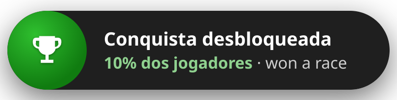
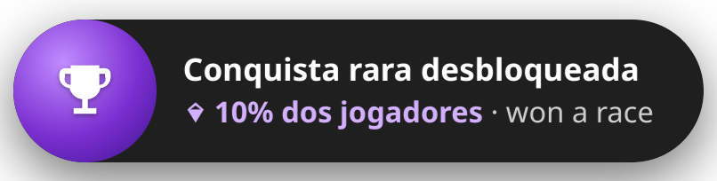
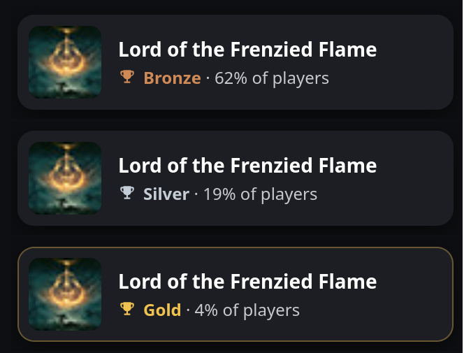
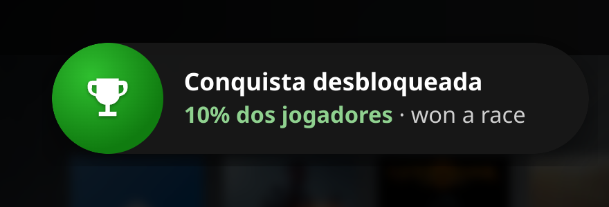

<h1 align="center">🏆 Achievo</h1>

<p align="center"><i>Console-style achievement toasts for the Steam Deck.</i></p>

<p align="center">
  <b>A <a href="https://github.com/SteamDeckHomebrew/decky-loader">Decky Loader</a> plugin that swaps Steam's achievement popup for a console-style one: Xbox Series X|S or PlayStation 5, your pick.</b><br>
  Xbox: the round badge pops in and the pill slides open, rare ones turn purple with sparkles. PlayStation: a trophy card with the achievement's art and a bronze, silver or gold grade.
</p>

<p align="center">
  
  
  
  
  <a href="https://buymeacoffee.com/kromossomoc"></a>
</p>

---

## ✨ Preview

<table>
  <tr>
    <td width="50%"></td>
    <td width="50%"></td>
  </tr>
  <tr>
    <td align="center"><sub><b>Achievement unlocked</b>: % of players and the achievement's name</sub></td>
    <td align="center"><sub><b>Rare achievement</b>: purple badge, sparkles and a three-note chime</sub></td>
  </tr>
</table>

<p align="center">
  
  <br><sub><b>PlayStation 5 style</b>: the achievement's art, its name and a trophy grade based on how rare it is</sub>
</p>

<p align="center">
  
  <br><sub>Put it anywhere: top, middle or bottom, left, center or right.</sub>
</p>

<sub>Xbox toasts captured in Steam's Big Picture mode with Steam in Portuguese; the PlayStation cards are rendered from the same code in English.</sub>

## 📦 Install

<p align="center">
  <a href="https://github.com/kromossomom-debug/decky-achievo/raw/main/achievo.zip">
    
  </a>
</p>

1. Download **[achievo.zip](https://github.com/kromossomom-debug/decky-achievo/raw/main/achievo.zip)** on your Deck (it goes to your Downloads folder).
2. Open Quick Access (`…`) → **Decky** → ⚙️ → **General** and turn on **Developer mode**.
3. Under **Developer → Install Plugin from ZIP**, pick the file from Downloads. Done.

> Requires [Decky Loader](https://github.com/SteamDeckHomebrew/decky-loader). Works on its own or next to
> [Xbox Dashboard](https://github.com/kromossomom-debug/decky-xbox-dashboard).

## 🎮 Features

| | |
|---|---|
| 🎮 **Two styles** | **Xbox Series X\|S** or **PlayStation 5**, picked in the panel. Each has its own look, chime and usual spot on the screen. |
| 🟢 **Xbox-style toast** | The badge pops in with a ring pulse, the pill slides open with **Achievement unlocked**, the % of players and the achievement's name, then folds back into the badge and disappears. |
| 💜 **Rare achievements** | Achievements fewer players have than your threshold (10% by default) get **Rare achievement unlocked**, a purple badge, a diamond and sparkles. |
| 🏆 **PlayStation trophy card** | A dark rounded card that drops in with the achievement's art (with a light sweep), its name and a trophy grade: **Gold** for rare ones, **Silver** under 30% of players, **Bronze** otherwise. |
| 📍 **Any position** | Top, middle or bottom; left, center or right (9 spots), plus how far from the edge. Bottom center for Xbox and top right for PlayStation by default. |
| 🔔 **Chime** | An original chime for each style, made on the fly, with its own volume: a bright two-note “bling” for Xbox (three notes for rare ones), a soft bell “ting” for PlayStation (two notes for gold). |
| 🎵 **Your own sound** | Pick any MP3, OGG, WAV or FLAC file (up to 3 MB) and it plays instead. Or keep Steam's sound, or none. |
| 🧪 **Test buttons** | Fire a normal or rare test toast from the panel, using a game you played recently. |
| 🌐 **English & Portuguese** | Follows Steam's language. |

### About the sound

The Xbox and PlayStation sounds belong to Microsoft and Sony, so they can't be shipped here. The
plugin's chimes are original sounds in the same spirit. If you have a sound file you want to use, choose **My sound file** in
the panel and pick it.

## ⚙️ Settings

Everything lives in the plugin's panel in Quick Access. Your choices are saved to
`~/homebrew/settings/achievo/settings.json`.

| Option | Default | What it does |
|---|---|---|
| Console-style notification | on | Turns the console toast on or off (off = Steam's own popup) |
| Style | Xbox Series X\|S | Xbox Series X\|S or PlayStation 5 |
| Achievement sound | Style's chime | Chime, your sound file, Steam's sound or no sound |
| Volume | 80 | Volume of the chime or your file |
| Where it shows | Bottom center (Xbox) / top right (PlayStation) | One of 9 spots on the screen. Switching style moves it to that console's spot unless you chose another one |
| Distance from the edge | 24 px | 0 to 120 px |
| Rare below | 10% | Achievements below this % of players get the rare toast (gold trophy on PlayStation) |
| Show % of players | on | Shows how many players have the achievement |

Progress notifications (“3/10”) keep Steam's own look.

## 🛠️ How it works

- **Steam's own toast window.** In Game Mode Steam draws notifications in a small window that sits above
  games. When an achievement comes in, the plugin hides Steam's content in that window and draws the Xbox
  pill or trophy card there, so it shows over games exactly like Steam's does.
- **Moving it.** That window follows a placeholder in Steam's main window. While an Xbox toast is up, the
  plugin moves the placeholder to your chosen spot; afterwards Steam's other notifications go back to
  their usual corner.
- **The sound.** Steam picks a sound for every notification; for achievements the plugin plays the chime
  or your file instead.
- **No hard-coded class names.** Steam's CSS class names change with updates, so the plugin looks them up
  by name at runtime.
- **Your data stays on the Deck.** No outside requests.

<details>
<summary><b>Project layout</b></summary>

```
src/
├── index.tsx    # plugin entry, Quick Access panel, toast and sound hooks
├── toast.ts     # the Xbox pill and PlayStation card (markup, CSS, animations)
├── place.ts     # moves the toast to the chosen spot
├── sound.ts     # the chimes and custom sound playback
├── settings.ts  # options and defaults
└── i18n.ts      # English and Portuguese text
main.py          # saves settings, reads your sound file
```

</details>

## 🧑‍💻 Development

```bash
npm install
npm run build        # outputs dist/index.js
npm run package      # build + achievo.zip
```

Every push is built by GitHub Actions. To release, add a section for the new version to
[CHANGELOG.md](CHANGELOG.md), then push a tag such as `v0.0.2-alpha`: the release is published with
the ZIP attached and that section as its notes.

## ☕ Support the project

If you like the plugin and want to say thanks, buy the author a coffee. It helps keep it updated when
Steam changes.

<p align="center">
  <a href="https://buymeacoffee.com/kromossomoc">
    
  </a>
</p>

You can also open the page right from the Deck: plugin panel → **Support the project → Buy Me a Coffee**.

## ⚠️ Disclaimer

A fan project, not affiliated with Microsoft, Xbox, Sony, PlayStation or Valve. “Xbox” and “Xbox Series X|S”
are trademarks of Microsoft. “PlayStation” and “PS5” are trademarks of Sony Interactive Entertainment.
“Steam” and “Steam Deck” are trademarks of Valve. No Microsoft or Sony sounds, logos or artwork are included.

## 📝 Changelog

What changed in each version: [CHANGELOG.md](CHANGELOG.md).

## 📄 License

[MIT](LICENSE)
